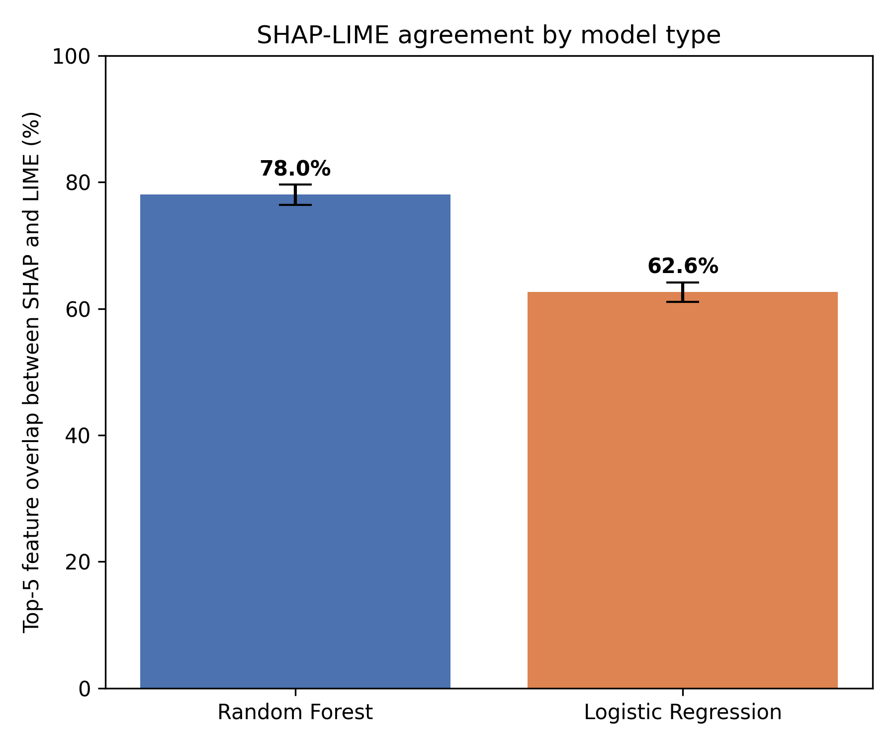

# xai-shap-vs-lime
Do SHAP and LIME agree? Explainable AI comparison across 61 test patients, 2 models, with statistical testing

# SHAP vs LIME: Do Explanation Methods Agree?

A small benchmark comparing two explainable-AI methods, SHAP and LIME, on tabular medical data.

Question:When SHAP and LIME explain the same prediction, how often do they agree on the most important features, and does it depend on the model type?

## Setup
- Dataset: Heart Disease (303 patients, 13 features)
- Models: Random Forest (83.6% accuracy), Logistic Regression (85.2% accuracy)
- Metric: overlap of top-5 features between SHAP and LIME, per patient, across all 61 test patients
- Test: Wilcoxon signed-rank (paired)

## Results
| Model | SHAP-LIME top-5 overlap |
| Random Forest | 78.0% |
| Logistic Regression | 62.6% |

Difference is statistically significant (p = 4.3e-8).

## Key takeaway
Agreement between SHAP and LIME depends on the model. Looking at a single patient suggested the opposite trend, so evaluating across all test patients mattered.

## Limitations
One small dataset, two models, default explainer settings, top-5 overlap ignores feature order. LIME seed fixed at 42 for reproducibility.

## Tools
Python, scikit-learn, SHAP, LIME, SciPy, Matplotlib
